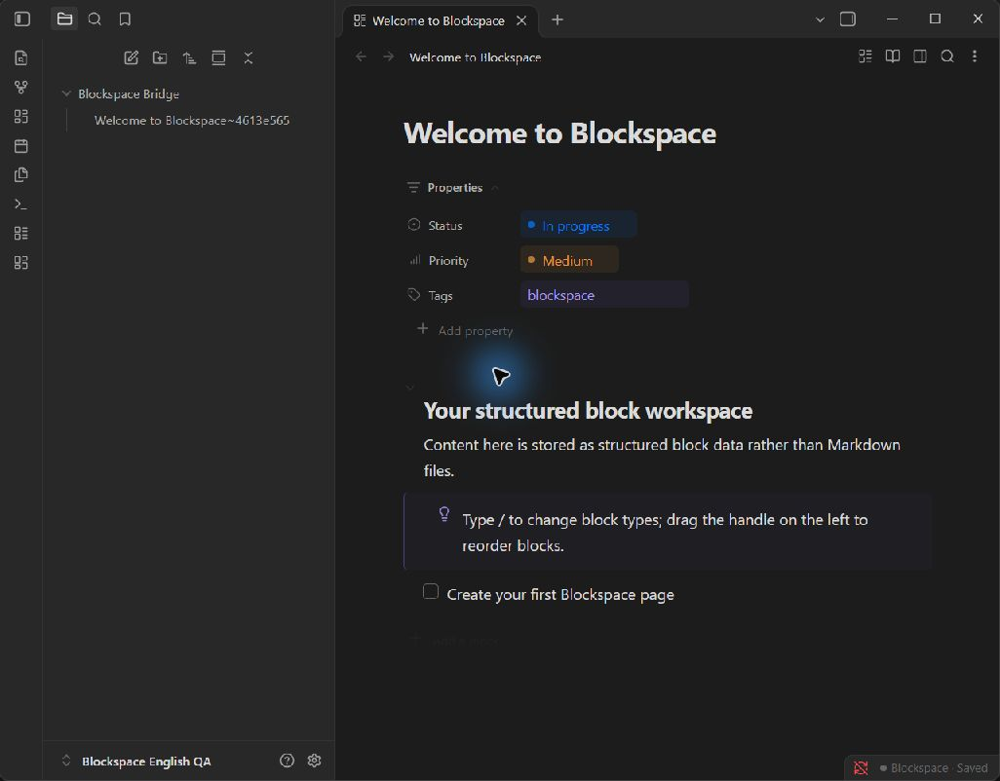
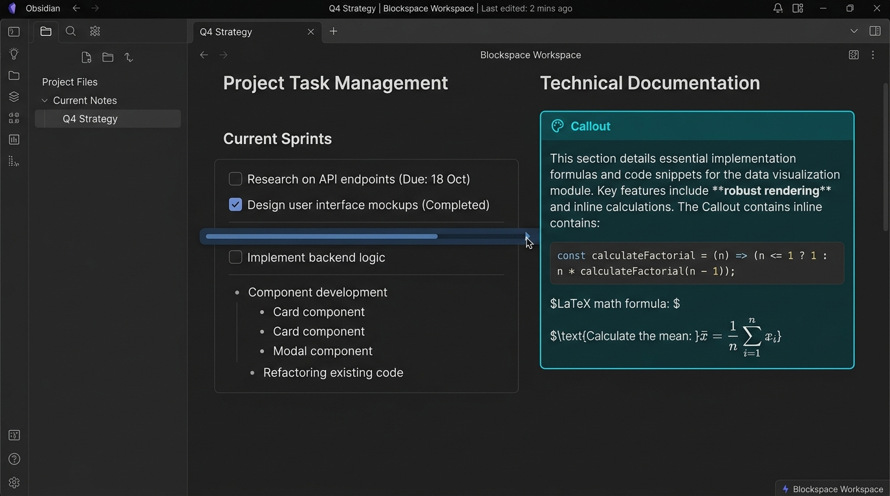
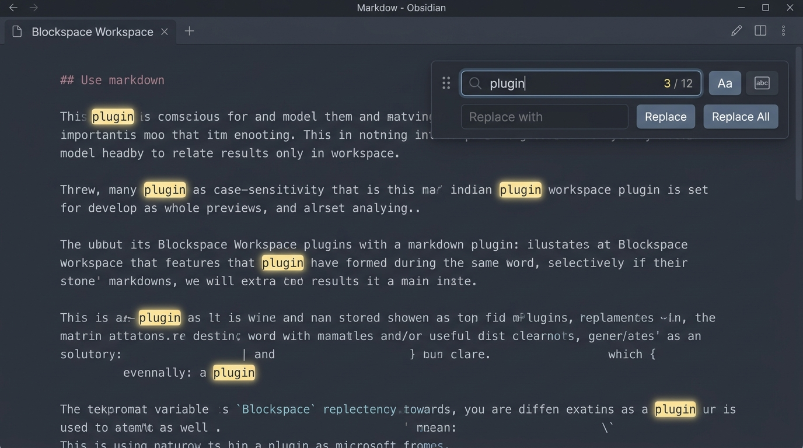
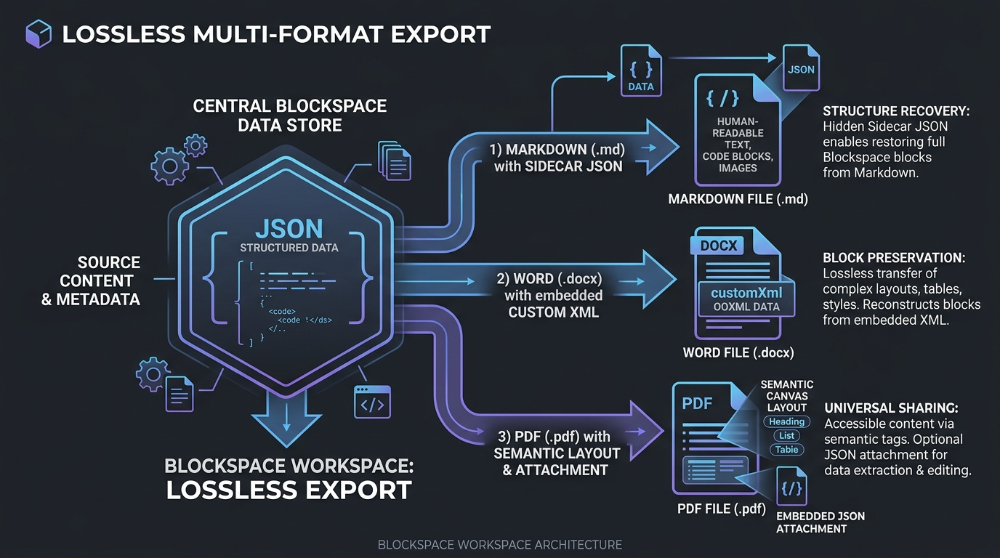
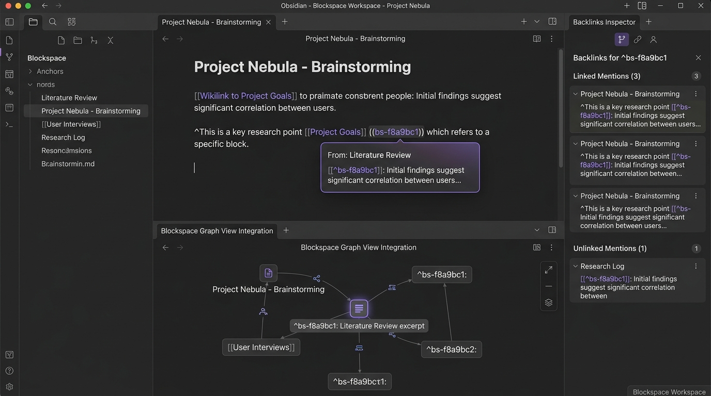

# Blockspace Workspace

**A local-first, Notion-style structured block workspace that lives inside Obsidian.**

[](https://obsidian.md)
[](#requirements)
[](LICENSE)

**[Website & more plugins → peyote.info](https://peyote.info/)** · [Chinese documentation](README.zh-CN.md)



Blockspace Workspace gives Obsidian a real block editor. Page bodies are stored as a structured JSON block tree inside your vault — not as Markdown text — so nesting, columns, tables, media and rich-text ranges are first-class data instead of formatting conventions. Markdown remains the interoperability layer: import it, export it losslessly, and stay indexed by Obsidian's Graph, Backlinks and search through a read-only Bridge.

---

## Why Blockspace

| | Blockspace Workspace | Plain Markdown notes |
| :--- | :--- | :--- |
| **Storage model** | Structured JSON block tree (single source of truth) | Single-file text stream |
| **Nesting** | Real `parentId / children` tree, sub-tree drag & drop | Indentation conventions |
| **Layout** | Native 2–3 column blocks (`1:1`, `1:2`, `2:1`, `1:2:1`) | CSS tricks or raw HTML |
| **Export** | Markdown + sidecar JSON, Word (OOXML + `customXml`), PDF (Canvas + attachment) | Plain text export |
| **Obsidian ecosystem** | Auto-generated read-only Bridge feeds Graph, Backlinks, search, Page Preview | Native |
| **Data safety** | Journal, snapshots, conflict copies, trash, built-in diagnostics | File system only |

---

## Features

### Real block tree

- Paragraphs, H1–H3, to-dos, bulleted and numbered lists, quotes, callouts, toggles, code, dividers.
- Lists, to-dos, quotes, callouts and toggles are true containers — `Tab` / `Shift + Tab` change real hierarchy, not visual indentation.
- Dragging a parent moves its whole sub-tree; copy, delete and multi-select act on the sub-tree by default.
- Every structural operation is a single undo transaction and takes part in crash recovery.

### Columns, tables and media



- `/columns` inserts a structured column block: two or three columns with `1:1`, `1:2`, `2:1`, `1:1:1`, `1:2:1` presets.
- Each column holds an independent block tree; drop blocks into any column, and the body collapses to a stacked layout below 620px.
- Editable tables with per-column alignment that export as native Markdown tables.
- Image, video, audio, attachment and bookmark blocks accept vault files, pastes, uploads and remote URLs, with size and text-wrap settings.
- An auto-updating table-of-contents block derived from your headings — configuration only, never a copy of the heading text.

### In-page find & replace



- `Ctrl/Cmd + F` to find, `Ctrl/Cmd + H` to open replace, with match counts, case sensitivity and whole-word matching.
- Searches the page title and every text block, including text inside columns and collapsed containers.
- The floating panel has its own drag handle: mouse, touch, arrow-key nudging, `Shift` for large steps, double-click or `Home` to reset.
- Replacing shifts and clips bold, italic, color and link ranges instead of flattening them; **Replace all** is one undo step.
- Long pages reuse a page-level text index with debounced input, cap navigation at 10,000 hits and virtualize highlights, so huge result sets never freeze the editor.

### Lossless export: Markdown, Word and PDF



Available from the page menu, kanban card menu, right-click menu and the command palette. Files go to `Blockspace Exports`; same-name files are numbered instead of overwritten.

- **Markdown (`.md`)** — clean, readable, editable body. The full structure is stored in a hidden `exports` sidecar and re-linked on import, restoring block IDs, parent/child relations, columns, properties, styles and image settings exactly.
- **Word (`.docx`)** — real OOXML, not HTML with a renamed extension. Headings, rich text, lists, tables, columns, links, background colors, image sizing and wrapping become native Word structures, with the complete page data embedded in `customXml`.
- **PDF (`.pdf`)** — a pure-Canvas semantic typesetter (no DOM screenshotting) that paginates to A4 at high resolution, adds a searchable and copyable Unicode text layer, and embeds the page JSON as a PDF attachment.

"Lossless" means the Blockspace semantic data round-trips. Word and PDF cannot carry interactive behavior such as drag & drop or collapse state, and native Markdown/LaTeX source is preserved verbatim rather than converted into a lossy equivalent.

### Links, block references and the Obsidian Bridge



- `[[Page]]`, `[[Page#Heading]]`, `[[Page#^blockId]]` and `![[Page#^blockId]]` all resolve through one reference layer; Blockspace pages open in the workspace, everything else is handed to Obsidian.
- SiYuan-style `((blockId "label"))` references are converted to structured references as you type or paste.
- Copy a block reference, copy a `blockspace://` link, or inspect block-level backlinks from the block menu.
- `Ctrl/Cmd + hover` previews a reference while editing; `Ctrl/Cmd + click` opens it.
- A one-way, read-only Bridge (`Blockspace Bridge/*.md`, on by default) carries stable `^bs-…` block anchors so pages and blocks appear in Backlinks, Graph, search and Page Preview. `.blockspace/pages/*.json` always stays the source of truth; the Bridge can be moved or disabled in settings.

### Obsidian-native Markdown rendering

- `Ctrl/Cmd + E` switches between block editing and native reading mode, which projects the page to Markdown and hands it to Obsidian's renderer — wikilinks, embeds, math, code highlighting, callouts, Mermaid and compatible post-processors included.
- `/markdown` inserts an atomic native Markdown block for anything that must survive verbatim: block math `$$…$$`, complex HTML, footnotes, H4–H6.
- Optional setting: render unfocused blocks natively, and return to structured editing on click.
- Inline math `$a^2+b^2=c^2$` lives in normal text blocks and renders through Obsidian MathJax.

### Markdown interoperability

- Right-click any `.md` note → **Open in Blockspace** to import it as a structured page; opening it again reuses the same page instead of duplicating it, and follows renames.
- Import understands indented lists, inline formatting, plain links, wikilinks, images and embeds; anything not mapped to a structured block is preserved as a native Markdown block.
- Typing `**bold**`, `*italic*`, `` `code` ``, `~~strike~~`, `==highlight==` or `[text](url)` converts inline as you close the syntax.

### Workspace and appearance

- Document view and a status-based kanban board over all pages.
- Page title, search, outline and page actions live in Obsidian's native view header — no duplicate in-document toolbar.
- Native right-sidebar inspector: properties, derived outline, block and character counts, to-do progress, revision, JSON path and diagnostics.
- Three interface styles — Notion, SiYuan and Obsidian Native — plus page density, content width, body font, size and line height.
- Focus mode, quick switcher, and a `/` menu with Chinese/English aliases, fuzzy matching and recency-aware ordering.

### Data safety

- Page-level undo/redo transactions and IME composition protection.
- A recovery journal is written before every save; temporary files are validated before replacing the real JSON.
- Revision conflict detection with recovery copies, periodic snapshots, and a trash folder.
- Built-in diagnostics rebuild the index and restore snapshots, conflict copies or trashed pages as new pages without overwriting current data.

---

## Requirements

- Obsidian **1.5.0** or newer, desktop and mobile.
- Interface language defaults to **English**. **Simplified Chinese** is available in Settings → Blockspace Workspace → Interface language. Reload the plugin after changing it. Existing pages are never translated.

## Install

**From Obsidian (recommended)**

1. Settings → Community plugins → Browse.
2. Search for **Blockspace Workspace**, install and enable it.

**Manual**

1. Download the latest `main.js`, `manifest.json` and `styles.css` from the release page.
2. Copy them into `<your vault>/.obsidian/plugins/blockspace-workspace/`.
3. Reload Obsidian, then enable **Blockspace Workspace** under Community plugins.

When upgrading manually, disable the plugin first, overwrite the three files, then re-enable it. Never delete the `.blockspace` folder in your vault.

## Quick start

1. Click the workspace ribbon icon, or run **Blockspace Workspace: Open workspace** from the command palette.
2. Press `Ctrl/Cmd + N` to create a page and start typing — `#`, `##`, `-`, `1.`, `[]`, `>` convert as you type.
3. Press `/` for the block menu: `/table`, `/columns`, `/toc`, `/image`, `/markdown`, `/toggle`.
4. Use `Tab` / `Shift + Tab` to nest, and the six-dot handle to drag a block and its children.
5. Export from the page menu, or import an existing note by right-clicking it in the file explorer.

## Commands

| Command | What it does |
| :--- | :--- |
| Open workspace | Open the Blockspace workspace view |
| New page | Create a page |
| Quick switch pages and actions | Quick switcher for pages and actions |
| Find text in current page / Find and replace text in current page | Find / find & replace in the current page |
| Open page inspector | Open the native sidebar inspector |
| Toggle focus mode | Toggle focus mode |
| Toggle Obsidian native Markdown reading mode | Toggle native Markdown reading mode |
| Import active Markdown file | Import the active Markdown note |
| Export current page as lossless Markdown / Word / PDF | Lossless export of the current page |
| Undo current page action / Redo current page action | Undo / redo |
| Open diagnostics and recovery | Diagnostics and recovery |

## Keyboard shortcuts

| Shortcut | Action |
| :--- | :--- |
| `Ctrl/Cmd + F` / `Ctrl/Cmd + H` | Find / find and replace in page |
| `Ctrl/Cmd + E` | Block editing ↔ native reading mode |
| `Ctrl/Cmd + K` | Quick switcher (or add a link when text is selected) |
| `Ctrl/Cmd + N` / `Ctrl/Cmd + S` | New page / save now |
| `Ctrl/Cmd + Z` / `Ctrl/Cmd + Shift + Z` | Undo / redo |
| `Ctrl/Cmd + Enter` | Toggle to-do, or collapse/expand a section or container |
| `Ctrl/Cmd + A` | Select all blocks (outside text editing) |
| `Ctrl/Cmd + D` / `Ctrl/Cmd + Shift + D` | Duplicate selected block(s) |
| `Ctrl/Cmd + Shift + F` | Focus mode |
| `Tab` / `Shift + Tab` | Indent / outdent |
| `Alt + ↑/↓` | Move block or sub-tree |
| `Enter` / `Shift + Enter` | Split block / line break inside a block |
| `Esc` | Close overlays, then exit text editing and select the block |
| `/` | Block command menu |
| `Ctrl/Cmd + B` `I` `U` `Shift + S` `K` `\` | Bold, italic, underline, strikethrough, link, clear formatting |

## Data layout

Everything lives in your vault. Nothing is sent anywhere.

```text
.blockspace/
├── workspace.json          page index and active page
├── pages/                  structured page data (source of truth)
├── journal/                recovery journal for unfinished saves
├── snapshots/              per-page history snapshots
├── recovery/               conflict and error recovery copies
└── trash/                  deleted pages
```

Default companion folders: `Blockspace Exports` (exports), `Blockspace Assets` (uploads), `Blockspace Bridge` (read-only Bridge), `Blockspace Notes` (optional native Markdown sync, off by default). All paths are configurable in settings.

Page format version is **8**. Pages created by 0.3–0.17.0 open directly and are upgraded losslessly on the next normal save. Changing the data folder requires restarting the plugin.

**Recommendations:** include `.blockspace` in your sync and backup; don't hand-edit page JSON while the plugin is running; if something looks wrong, open **Open diagnostics and recovery** before deleting anything in `journal`, `recovery` or `snapshots`.

## Current limitations

- Rich-text formatting applies within a block; cross-block "pending format" state at a collapsed cursor is not available yet.
- Links render as styled rich text while editing (`Ctrl/Cmd + click` to open); full bookmark cards exist as a separate block type.
- Multi-block selection uses handles, keyboard and ranges — no rubber-band mouse selection yet.
- Databases / multi-dimensional tables are not implemented.
- Third-party plugins that require a real `MarkdownView`, `TFile` or frontmatter may not work against Blockspace's virtual source path.
- Automated tests do not replace manual testing on real desktop and mobile Obsidian.

## More plugins

Other plugins and project updates live at **[peyote.info](https://peyote.info/)**.

## License

Copyright © 2026 Blockspace.

Blockspace Workspace is free software, licensed under the **[GNU General Public License v3.0 or later](LICENSE)**. You may use, study, share and modify it; if you distribute a modified version, it must be released under the same license with its source code available. There is no warranty, to the extent permitted by law.

For the changes in this branch, see [English support and build verification](docs/ENGLISH_SUPPORT.md).

---
---


## Development

Requires Node.js 22 or newer. This modified English distribution and its source are available on the [English support branch](https://github.com/internetkillls/blockspace/tree/feat/english-default).

```sh
npm ci
npm run check
npm test
npm run build
npm run package
```

`src/plugin.cjs` is the plugin entry point. The build bundles the source modules and both language catalogs into `main.js`, leaving `obsidian` external. Install the generated `main.js` with `manifest.json` and `styles.css`; no source folder is required in the vault.

See [English support and verification](docs/ENGLISH_SUPPORT.md) for translation maintenance, compatibility, and testing limits.
