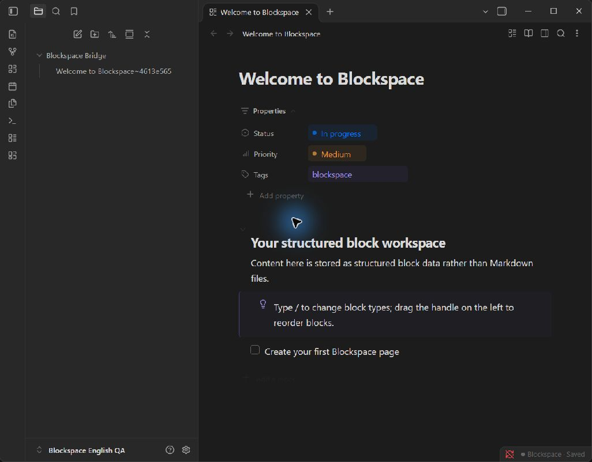
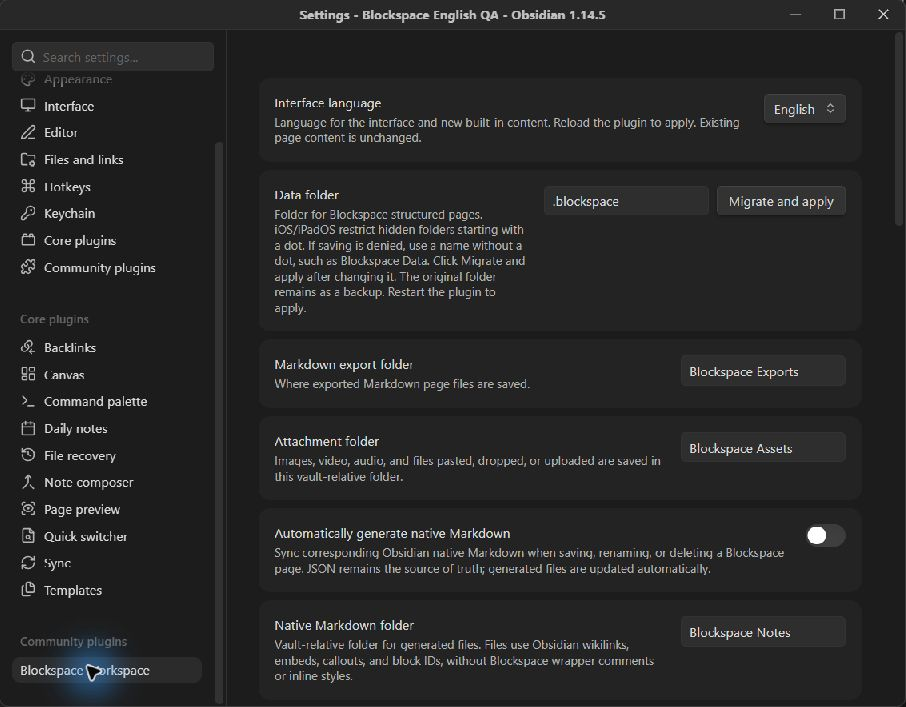

# English interface and reproducible build

## Language behavior

English (US) is the default, including existing installations without a language setting. Choose **English** or **简体中文** in Settings → Blockspace Workspace → Interface language, then reload the plugin. Changing the saved choice does not switch an already-open interface until reload.

Both languages remain available in slash-command searches. Command IDs, block types, status and priority values, storage paths, and page format version 8 remain unchanged. Welcome content, newly generated table headings, and other built-in content use the active language when created. Existing page text, titles, tags, custom property names and values, file names, and imported content are not translated.

The catalogs in `src/locales/en.json` and `src/locales/zh-CN.json` cover UI labels, accessibility text, notices, diagnostics, undo descriptions, export labels, and default content. The `src/i18n.cjs` module falls back to English for a missing translation. Messages interpolate numbered placeholders such as `{0}` without interpreting placeholder-like text in user values. Catalog messages containing HTML retain the existing escaped interpolation supplied by exporters.

To add a message, add the same key to both catalogs and call `t(key, [values])`. Keep IDs and parsing syntax outside translations. Run `npm run check` to validate key parity, placeholders, English text, source lookups, and the allowlist for intentionally retained Chinese search aliases.

## Entry point investigation

Source baseline: `4332a97fc654e8603e670acc0681f72bc8e20c51` (`main`).

The baseline `main.js` and `styles.css` belong to an unrelated Life Records plugin. The baseline bundle registers `open-life-timeline`, `add-timeline-post`, and `batch-import-images`, and has no `open-workspace` command. The original Blockspace stylesheet is restored from commit `46903285ce064eab77c3acaf279ea6eb9e6bc0e4` (the full Git object is retained in repository history). Its collapsed-heading label now comes from a translated data attribute; nested-placeholder styling no longer depends on Chinese wording.

The baseline `main.js` is a generated/minified bundle containing timeline and audio-transcription code, while `src/plugin.cjs` exports `BlockspaceWorkspacePlugin` with the workspace command IDs. It is not a reproducible build of the provided Blockspace sources. This branch replaces that bundle with a build of `src/plugin.cjs`. Obsidian remains an external runtime dependency. Both catalogs are embedded, so manual installation still needs only `main.js`, `manifest.json`, and `styles.css`.

The baseline README advertises version 0.17.1, but `manifest.json` declares 0.0.4. This branch retains manifest version 0.0.4 and removes the conflicting README badge. The baseline links to a missing `CHANGELOG.md`; those links are replaced with this branch's factual change record. No release history is invented.

## Verification

```sh
npm ci
npm run check
npm test
npm run build
```

Automated tests exercise English and Chinese startup, saved-language reload, unsupported-language and missing-message fallback, interpolation, bilingual slash searches, localized default content, mixed-language page preservation, Markdown sidecar round-trip, HTML/Word export labels and metadata, and the shipped bundle entry point. Plugin startup tests use a small Obsidian API stub; they do not establish real Obsidian interaction or mobile behavior.

The inherited documentation images already contain English labels. They are retained as illustrations, not evidence of this branch's runtime behavior.

Real desktop smoke testing used Obsidian 1.14.5 in a separate temporary QA vault/profile, with the generated package files. English welcome content, status and priority properties, editor accessibility text, save status, restored styles, and the settings language selector were observed. Choosing Chinese through the real dropdown wrote `zh-CN` to plugin settings. After restarting the QA profile, ribbon, page actions, accessibility labels, and priority labels appeared in Chinese while the existing English title and body stayed unchanged.





Desktop observation is a smoke test, not a complete interaction matrix. Automated API-stub tests cover menu/search/command registration; exhaustive desktop interaction and real PDF visual export remain unverified. Mobile testing is not available in this environment.

## REA investigation limits

REA CLI `rea-agents@6.8.0` was actually invoked against the local checkout. The installed Node 24.20.0 is below that release’s declared supported Node range. Static analysis of `main.js` reached the 300000 ms provider deadline and returned partial observation `ev_a017ada4fbc09182e94e7c54d2a88dc67943e6ce2cfc17e7454544c1cd942018`. Graph coverage is incomplete, and the analysis did not execute bootstrap code. This working-checkout analysis is not a pinned-baseline proof. The baseline entry-point findings above were separately checked against Git objects with Acorn syntax traversal; desktop screenshots establish only the behavior actually observed. No REA MCP connection or completed full analysis is claimed.

## Installation archive

Run `npm run package` to build `dist/blockspace-workspace-english.zip`. Extract its `blockspace-workspace` directory into your vault’s `.obsidian/plugins/` directory. Source code is available on the [English support branch](https://github.com/internetkillls/blockspace/tree/feat/english-default); this modified distribution remains GPL-3.0-or-later.
